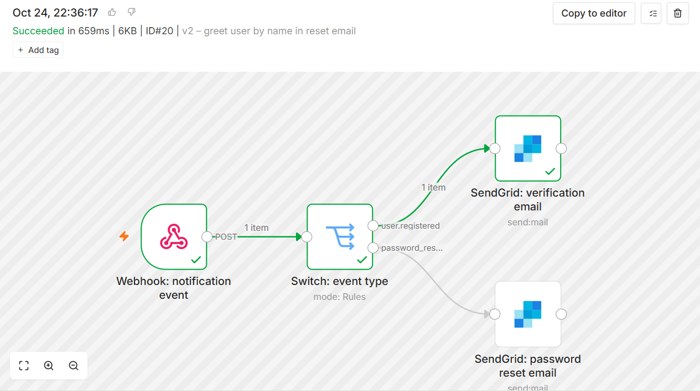
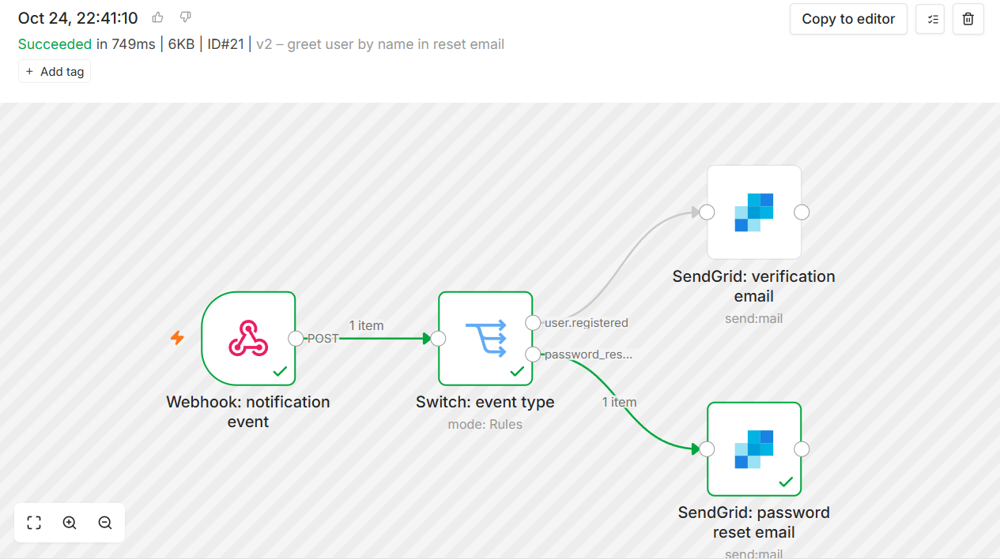
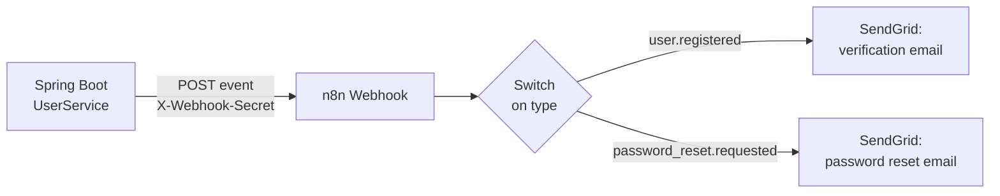

# Decoupled Notification Workflow (n8n)

> **Optional, off by default.** By default, the backend sends emails itself through the SendGrid Java SDK. If `N8N_WEBHOOK_URL` is set, it posts an event to an n8n webhook instead, and n8n sends the email.

| Verification email | Password reset email |
|---|---|
|  |  |

## Direct SendGrid (default)

When a user signs up (`POST /users`), `UserService.create()` saves the user with a random UUID `verificationToken`. It then calls `SendGridEmailService.sendVerificationEmail(email, token)`, which sends this message:

| SendGrid field | Value | Source |
|---|---|---|
| `from` | `SENDGRID_FROM_EMAIL` | env var |
| `to` | the new user's email | `User.email` |
| `subject` | `Verify your email address` | hard-coded |
| `content` (`text/plain`) | `Welcome! Please verify your account by clicking this link: <link>` | hard-coded + link |
| link | `${app.frontend.base-url}/login?token=<token>` | `application.properties` + `User.verificationToken` |

The password reset email (`POST /users/password-reset-request`) follows the same pattern. It uses the subject `Password Reset Request` and a `/reset-password?token=<token>` link.

## Through n8n

When `N8N_WEBHOOK_URL` is set, `N8nNotificationService` posts the event to n8n instead of calling SendGrid. n8n then owns the email: its template, sender, and provider credentials.



The events contain only data the backend already has:

```json
{
  "type": "user.registered",
  "email": "new.user@example.com",
  "name": "New User",
  "verificationLink": "http://localhost:3000/login?token=<uuid>"
}
```

```json
{
  "type": "password_reset.requested",
  "email": "user@example.com",
  "name": "Existing User",
  "resetLink": "http://localhost:3000/reset-password?token=<uuid>"
}
```

The n8n emails greet the user by `name`; the direct SendGrid emails don't.

### When something fails

The Webhook node is set to **Respond: When Last Node Finishes**. n8n answers the backend only after the email step has run, so a failure anywhere in the workflow reaches the backend as an error:

| What goes wrong | Result |
|---|---|
| n8n can't be reached, or times out (5 s to connect, 15 s to respond) | the signup or reset request fails with a 500 |
| n8n rejects the event (wrong secret: 403; workflow not published: 404) | fails with a 500 |
| SendGrid rejects the email inside n8n (e.g. out of credits, unverified sender) | fails with a 500, and the error workflow sends an alert |

The user record is saved before the email step either way. The backend log includes the original error.

The trade-off: each signup waits for the email to be sent, typically under a second. With **Respond: Immediately**, signups return faster, but SendGrid failures are only visible under **Executions** in n8n.

The direct SendGrid path handles failures the same way. The SendGrid library only throws on network errors, so `SendGridEmailService` also checks the response status and treats any 4xx or 5xx (e.g. `401 Maximum credits exceeded`) as a failed send.

### Error alerts

[n8n-error-alert-workflow.json](n8n-error-alert-workflow.json) is a separate workflow: an **Error Trigger** followed by a SendGrid node that emails the workflow name, the failed node, the error message and a link to the failed run. It's set as the **Error workflow** of the main workflow (see Setup).

- n8n only runs error workflows for production runs, not for manual **Execute** runs in the editor.
- The alert also goes through SendGrid, so it can't arrive if SendGrid itself is the problem (e.g. out of credits). For alerts you can rely on, use a different channel, such as n8n's Gmail or Slack node.

## Workflow files

| File | Contents |
|---|---|
| [n8n-notifications-workflow.json](n8n-notifications-workflow.json) | The main workflow: one webhook, a Switch on `type`, and one SendGrid node per email. It requires the `X-Webhook-Secret` header. |
| [n8n-error-alert-workflow.json](n8n-error-alert-workflow.json) | The error workflow: emails an alert when a run of the main workflow fails. |

## Setup

1. In n8n, import `n8n-notifications-workflow.json`.
2. In the **Webhook** node, create a **Header Auth** credential. Set **Name** to `X-Webhook-Secret` and **Value** to a long random string.
3. In both **SendGrid** nodes, select your SendGrid credential and set **Sender Email** to your verified sender.
4. Import `n8n-error-alert-workflow.json`. In its SendGrid node, select your credential, set **Sender Email** to your verified sender and **Recipient Email** to the address that should get alerts. Save and publish it.
5. In the main workflow, open **⋯ → Settings**, set **Error workflow** to "AI Chat App → Error Alert" and save.
6. Publish the main workflow so the production URL (`/webhook/...`) stays live. For testing, you can use the test URL (`/webhook-test/...`) instead. It only accepts one request each time you click **Execute workflow**.
7. Add the following to `.env` and restart the backend:
   ```
   N8N_WEBHOOK_URL=https://<your-instance>.app.n8n.cloud/webhook/ai-chat-notifications
   N8N_WEBHOOK_SECRET=<the same random string>
   ```

To switch back to direct SendGrid, leave `N8N_WEBHOOK_URL` empty and restart the backend.

> **Keep the secret set.** Without it, anyone who finds the production URL can make your SendGrid account send emails to any address. If the secret is exposed, generate a new one and update both `.env` and the n8n credential.

## Tests

- `N8nNotificationServiceTest`: the exact event payloads, the secret header, and error handling, against a mock server.
- `UserServiceNotificationTest`: `UserService` chooses n8n or SendGrid based on `N8N_WEBHOOK_URL`, and keeps the original error when a send fails.
- `SendGridEmailServiceTest`: a rejected email (4xx) and a network error both count as failed sends.

Run them with `./mvnw test`.

## Troubleshooting

| Symptom | Likely cause |
|---|---|
| The app shows "Signup failed" and no user is created | The browser request was blocked by CORS (`403 Invalid CORS request`). `CORS_ALLOWED_ORIGINS` replaces the `http://localhost:3000` default, so include every origin you use. |
| Backend log shows n8n `404 … webhook is not registered` | The workflow isn't published, or `N8N_WEBHOOK_URL` points at the test URL without a listening **Execute** run. |
| Backend log shows n8n `403 Authorization data is wrong!` | `N8N_WEBHOOK_SECRET` doesn't match the n8n Header Auth credential. |
| n8n shows "Authorization failed – please check your credentials" on a SendGrid node | Open the node's error details for SendGrid's actual response. `401 Maximum credits exceeded` means the account is out of credits, not that the API key is wrong. |

## Why decouple

- **Faster changes:** the email copy or provider can change in n8n without redeploying the backend.
- **Room for more:** further steps, such as a Slack alert on new signups or a CRM entry, are workflow changes, not code changes.
- **A single integration point:** the backend only knows about one webhook, whichever email provider n8n uses.
